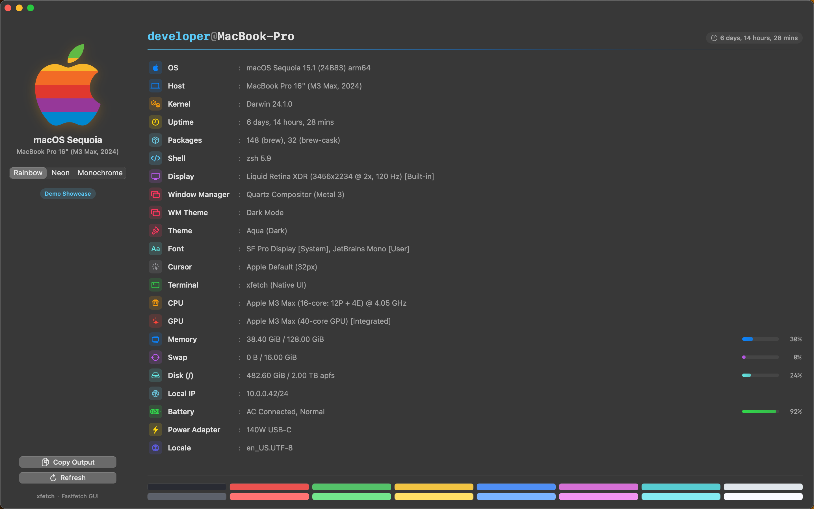

# xfetch

<p align="center">
  
</p>

<p align="center">
  <strong>System fetch, reimagined as a native macOS desktop experience.</strong><br />
  A zero-dependency graphical system telemetry tool that brings the elegance of modern macOS typography, translucent glass vibrancy, and live hardware meters to your Mac — no terminal required.
</p>

<p align="center">
  
</p>

<p align="center">
  
  
  
  
  
  
</p>

---

## Why xfetch

Terminal fetch tools are beloved for their crisp system summaries and iconic branding, but they demand an open shell window, a terminal emulator, and custom dotfile configurations.

**xfetch** extracts system fetch from the command-line boundary and presents it as a purpose-built macOS desktop application. Launch it from Spotlight, Alfred, or your Dock, and your Mac's full hardware, operating system, and runtime metrics are rendered instantly inside an AppKit-backed frosted glass window.

* **100% Native & Zero Dependencies**: Built entirely in Swift with direct Darwin kernel, Mach VM, IOKit, Metal, and AppKit integration. No external binaries or shell scripts required.
* **Instantaneous Telemetry**: Gathers complete hardware and operating system telemetry in sub-millisecond execution times without spawning subprocesses.
* **Graphical Visual Meters**: Raw memory, swap, and disk byte counts are converted into intuitive gradient progress bars and percentage badges.
* **Frosted Glass Vibrancy**: Seamlessly adapts to macOS dark and light appearances using native `NSVisualEffectView` under-window background blending.

---

## Key Capabilities

### Pure Swift Kernel & Hardware Probing
xfetch queries low-level macOS subsystems directly through native Swift Darwin APIs:
* **Operating System & Kernel**: Darwin `sysctlbyname` resolution for OS marketing name (Sequoia, Sonoma, Ventura, Monterey), release versions, Darwin build identifiers, and architecture.
* **Processor & Cores**: CPU brand strings and active logical core topologies.
* **GPU Detection**: Direct Metal framework queries (`MTLCopyAllDevices()`) reporting dedicated and integrated graphics processors.
* **Memory & Swap**: Mach VM 64-bit host statistics (`vm_statistics64`) tracking active, wired, and compressed memory against physical capacity, paired with dynamic swap usage metrics.
* **Storage & APFS**: POSIX `statfs` inspection of the root file system with capacity and utilization meters.
* **Power & Battery**: IOKit power source APIs (`IOPSCopyPowerSourcesInfo`) reporting battery health, percentage, and charging states.
* **Network & Local IP**: Native `getifaddrs` traversal resolving primary active IPv4 network interface addresses.

### Live Telemetry with Gradient Meters
Instead of plain text numbers, resource-constrained modules feature responsive visual meters:
* **Memory & Swap**: Tracks active and compressed allocations against capacity with custom gradient bars.
* **Storage**: Highlights volume utilization and free space on the root mount.
* **Battery**: Visualizes current charge levels and active charging states.

### Customizable Vector Identity
Switch effortlessly between three distinct Apple emblem treatments in the sidebar:
* **Rainbow**: The classic 1977 6-color vintage Apple horizontal stripe palette.
* **Neon**: A modern cyan-to-purple gradient with ambient soft drop shadow.
* **Monochrome**: A clean, high-contrast monochrome vector symbol adapting to dark and light modes.

### One-Click Clipboard Export
Press `Cmd + C` or click **Copy Output** to place a clean, formatted plain-text system summary onto the macOS clipboard with visual confirmation feedback, ready for bug reports, GitHub issues, or system discussions.

---

## How It Works

```text
┌─────────────────┐       ┌────────────────────────┐       ┌────────────────────────┐
│   App Launch    │ ────> │   Native SystemProbe   │ ────> │  SwiftUI Reactive UI   │
│  Spotlight/Dock │       │  Darwin / IOKit / Metal│       │ Frosted Glass + Meters │
└─────────────────┘       └────────────────────────┘       └────────────────────────┘
                                                                       │
                                                                       ▼
                                                           ┌────────────────────────┐
                                                           │  Clipboard Export      │
                                                           │  Plain-text (Cmd + C)  │
                                                           └────────────────────────┘
```

1. **Launch**: Open `xfetch.app` via Dock, Finder, Spotlight, or `open build/xfetch.app`.
2. **Telemetry Ingestion**: The background service queries Darwin kernel `sysctl`, Mach VM statistics, IOKit power sources, and Metal devices asynchronously without subprocesses.
3. **Structured Rendering**: Values are formatted into clean key-value items with SF Symbol iconography and gradient progress meters.
4. **Action**: View live metrics, toggle display themes, export to clipboard (`Cmd + C`), or refresh on demand (`Cmd + R`).

---

## Keyboard Shortcuts

| Shortcut | Action | Description |
|---|---|---|
| <kbd>⌘</kbd> + <kbd>R</kbd> | **Refresh** | Re-queries the native kernel probe and updates live system metrics with animation. |
| <kbd>⌘</kbd> + <kbd>C</kbd> | **Copy Output** | Copies the formatted text summary directly to your clipboard. |
| <kbd>⌘</kbd> + <kbd>W</kbd> | **Close Window** | Closes the main application window. |
| <kbd>⌘</kbd> + <kbd>Q</kbd> | **Quit** | Terminates the application instance. |

---

## Quick Start

### Build and Run Locally

Ensure you are running macOS 12.0 or later with Xcode Command Line Tools installed.

```bash
# Clone the repository
git clone https://github.com/unamatasanatarai/xfetch.git
cd xfetch

# Compile the application bundle into build/xfetch.app
make build

# Launch the application
make run
```

---

## Makefile Automation

The included `Makefile` orchestrates the complete project lifecycle:

| Target | Description |
|---|---|
| `make build` | Compiles the standalone `.app` bundle into `build/` and increments `BUILD_NUMBER`. |
| `make run` | Terminates active instances, recompiles, and opens `xfetch.app`. |
| `make test` | Executes the native Swift test suite covering parsers, models, and kernel probes. |
| `make kill` | Terminates any running `xfetch` processes. |
| `make dmg` | Packages the compiled `.app` into a distributable, styled macOS disk image. |
| `make revoke` | Resets local TCC permissions and flushes macOS LaunchServices caches. |
| `make clean` | Removes `build/` artifacts and temporary binaries. |

---

## Architecture & Codebase Tour

```text
xfetch/
├── Makefile                          # Build lifecycle and packaging automation
├── Package.swift                     # Swift Package Manager manifest
├── VERSION                           # Semantic version source of truth
├── BUILD_NUMBER                      # Auto-incrementing build counter
├── Resources/
│   ├── AppIcon.icns                  # macOS multi-resolution squircle icon
│   ├── AppIcon.png                   # 512x512 application branding asset
│   ├── dmg_background.png            # Styled DMG installer background (1x)
│   ├── dmg_background@2x.png         # Retina DMG installer background (2x)
│   └── shot_20261108_194823.png      # Product showcase screenshot
├── Sources/
│   └── App/
│       ├── Main.swift                # Application entry point (@main)
│       ├── AppDelegate.swift         # Window lifecycle, menus, and shortcuts
│       ├── AppConfig.swift           # Application metadata resolution
│       ├── Models/
│       │   └── FetchData.swift       # Module definitions and text parsing
│       ├── Services/
│       │   ├── FetchService.swift    # Asynchronous state and clipboard management
│       │   └── SystemProbe.swift     # Pure Swift Darwin, Mach, IOKit & Metal probe
│       └── Views/
│           ├── ContentView.swift     # Two-column split layout container
│           ├── AppleLogoView.swift   # Vector Apple emblem (Rainbow / Neon / Mono)
│           ├── FetchRowView.swift    # Spec row with icon, label, and progress meter
│           ├── ColorPaletteView.swift# 16-color ANSI terminal palette pills
│           └── VisualEffectView.swift# NSVisualEffectView frosted glass bridge
└── Tests/
    └── AppTests/
        ├── AppTests.swift            # 10 unit test specs covering telemetry engines
        └── TestMain.swift            # Standalone test runner entry point
```

---

## Quality & Testing

xfetch includes a native Swift test suite validating data parsing, percentage calculation, icon mapping, and Darwin kernel probes without external testing dependencies:

```bash
make test
```

```text
==================================================
         Running Swift Native Test Suite          
==================================================

--- Application Configuration & State Suite ---
  ✔ PASS: AppConfig returns valid non-empty application name
  ✔ PASS: AppConfig returns valid bundle identifier
  ✔ PASS: AppConfig provides version string
  ✔ PASS: AppConfig provides build number
  ✔ PASS: FetchItem percentage extractor extracts percentage correctly
  ✔ PASS: FetchItem generates unique IDs for identical keys
  ✔ PASS: FetchItem resolves appropriate SF Symbol icons and colors
  ✔ PASS: FetchData parses text summary accurately
  ✔ PASS: SystemProbe generates comprehensive native macOS telemetry
  ✔ PASS: FetchService performs asynchronous native refresh

--------------------------------------------------
  Summary: 10 Passed | 0 Failed (Total: 57.51ms)
==================================================
```

---

## Packaging & Distribution

To generate a distributable, signed disk image (`.dmg`) styled with custom backgrounds and icon layouts:

```bash
make dmg
```

The resulting artifact is written to `build/xfetch-0.0.0.dmg`.

---

## License

This project is licensed under the **GNU General Public License v2.0 (GPL-2.0)**. See the [LICENSE](LICENSE) file for terms and conditions.
